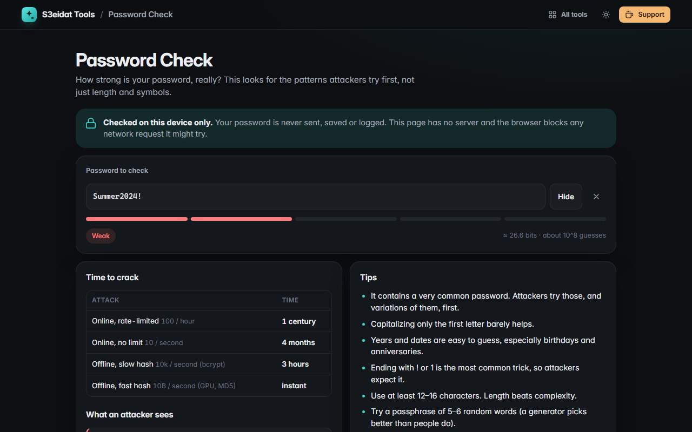

# Password Check

> How strong is your password, really? A pattern-aware strength check. Free, private, and it runs entirely in your browser.

### ▶ [Open Password Check](https://s3eidat.github.io/password-check/)



## Features

- **Pattern detection** like the tools attackers use, not just "has a symbol":
  - 1,282 **common passwords** (`123456`, `qwerty123`, `iloveyou`…) with their rough popularity rank
  - 2,381 **English words**, also **reversed**, **capitalised** and with **l33t swaps** (`P4ssw0rd` → `password`)
  - **Keyboard walks** on QWERTY and the number pad (`qwerty`, `1qaz2wsx`, `789456`)
  - **Sequences** (`abcdef`, `9876`), **repeats** (`aaaa`, `abcabc`), **years** and **dates** (`19/07/1994`, `071994`)
- Picks the **cheapest way to cover the whole password** and shows each piece with its cost in bits
- **Estimated crack times** for four attacks: online rate-limited (100/hour), online unlimited (10/s),
  offline slow hash (10k/s, bcrypt-like) and offline fast hash (10 billion/s, GPU + MD5-like)
- **Concrete tips** based on what it found
- Masked input with a Show toggle; pieces stay masked while the password is hidden

The scoring follows the approach of Dropbox's zxcvbn (minimum guesses over a match sequence), with a much smaller
embedded dictionary so the page stays light. Words and names it doesn't know are treated as random letters,
so the estimate is an upper bound: if it says "weak", it is.

## Privacy

Your password never leaves your device. It isn't saved, logged, or put in the URL, and the field is cleared when you leave
the page. There is no server, no account, no analytics. The page ships with a strict Content-Security-Policy
(`connect-src 'self'`), so the browser itself blocks any attempt to send data anywhere.

## Run it yourself

It's plain HTML, CSS and JavaScript with no build step:

```bash
git clone https://github.com/s3eidat/password-check
cd password-check
python -m http.server 8000
```

Then open http://localhost:8000.

## Support

If this saved you time, **[buy me a coffee ☕](https://s3eidat.github.io/coffee/)**. It keeps every tool free.

---

Part of **[S3eidat Tools](https://s3eidat.github.io/)**: 100+ free, private tools that run in your browser. MIT licensed.
